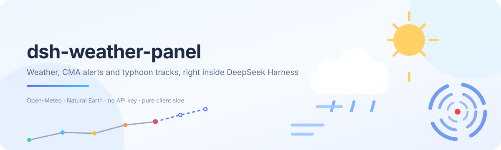
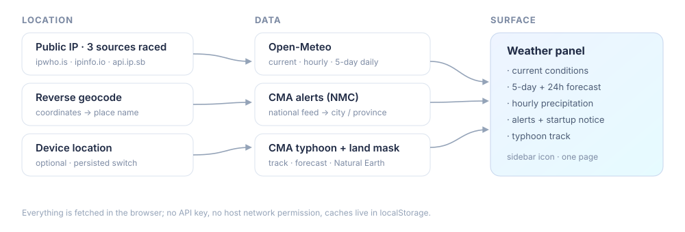
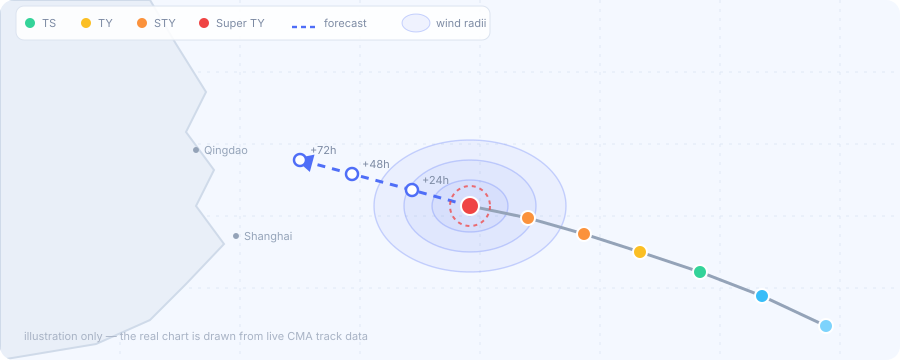

<div align="center">
  
</div>

<h1 align="center">dsh-weather-panel · DSH 天气面板</h1>

<p align="center">
  <a href="LICENSE"></a>
  <a href="https://github.com/deepseek-ai"></a>
  
  
  
</p>

<p align="center">
  <b>按网络自动定位的天气面板</b>：主要气象参数、未来 5 天与 24 小时预报、逐小时降水、
  <b>中央气象台（CMA）预警</b>与<b>台风路径</b>，开 DSH 时有雨或预警会弹窗提醒。<br/>
  纯浏览器端取数 · 不需要 API Key · 不占宿主网络权限 · 与其它插件并存
</p>

---

## 一张图看懂数据流

<div align="center">
  
</div>

## 功能

| 区块 | 内容 |
| --- | --- |
| 当前天气 | 温度、天气现象（WMO 码本地化）、体感、今日最高/最低 |
| 主要参数 | 湿度、海平面气压、风向+风速、阵风、降水、云量、紫外线（含等级）、降水概率、日出、日落、观测时刻 |
| 未来 5 天 | 每天最高/最低、天气现象、降水概率、降水量、最大风速、紫外线最大值 |
| 未来 24 小时 | 逐时温度、天气图标、降水概率 |
| 逐小时降水图 | 24 小时降水柱状图 + 降水概率虚线，悬停显示每个小时的具体数值 |
| 气象预警 | 中央气象台全国预警按「本市 → 本省」匹配，显示等级/类型/发布时间，附原文链接 |
| 台风路径 | 活跃台风或最近一次：**离线海岸线底图**、轨迹、预报路径、强度配色、风圈；可点选轨迹点看当时气压/风速/移动，一键「回到当前时刻」 |
| 启动提醒 | 打开 DSH 后，若今日有降水或生效预警则弹窗（需确认）；当天已确认不再打扰，**出现新预警会再次提醒** |
| 位置 | 自动（公网 IP）/ **高精度系统定位开关（持久，下次启动仍生效）** / 手动搜索城市，副标题标明来源、IP 与精度 |
| 代理提示 | 出口 IP 不在中国大陆时，顶部提示「可能开了代理/VPN，请手动切换城市」 |
| 交互 | 刷新、°C/°F 与 km/h / mph 切换（持久化）、关闭面板；数据每 **10 分钟**自动刷新（页面隐藏时暂停，切回补刷） |

## 界面

**天气页**：当前天气大卡 + 8 项气象参数 + 未来 5 天卡片 + 逐小时降水图与 24 小时条带；左侧栏点一次即达。

**台风页**：有台风时自动出现页签。

<div align="center">
  
  <br/>
  <sub>示意图：实际图形由中央气象台轨迹数据实时绘制（等距圆柱投影 + Natural Earth 陆地轮廓）</sub>
</div>

**启动提醒**：`天气提醒` 弹窗里有降水与预警摘要，「知道了」按钮用主题文字色，浅色/深色主题都清晰。

## 安装

要求：DeepSeek Harness **0.2.x** 的 Web UI，本机 Node.js ≥ 22（只用于安装与构建，插件本身跑在浏览器）。

1. 把仓库放到任意目录，例如 `C:\path\to\dsh-weather-panel`。
2. 让 Agent 执行插件安装（`plugin_manager` 的 `install_bundle`，目标填**仓库目录的绝对路径**）：

   ```
   install_bundle  target: C:\path\to\dsh-weather-panel
   ```

   返回 `application: "applied"` 即为生效。
3. 刷新 Web 页面，左侧栏出现「天气」图标。

卸载：在「插件」页停用/移除 `dsh-weather-panel`；本地仓库不会被改动。

## 数据来源与许可

| 用途 | 服务 | 说明 |
| --- | --- | --- |
| 天气/预报 | [Open-Meteo](https://open-meteo.com/) | 免 Key；数据 **CC BY 4.0**，面板底部保留署名 |
| 网络定位 | [ipwho.is](https://ipwho.is/)、[ipinfo.io](https://ipinfo.io/)、[api.ip.sb](https://ip.sb/) | 三源并发竞速，先可用者胜；单源失败不影响面板 |
| 逆地理编码 | [BigDataCloud](https://www.bigdatacloud.com/) | 坐标 → 「青岛市 · 黄岛区」 |
| 城市搜索 | Open-Meteo Geocoding | 中文查询自动追加「市」变体并重排 |
| **气象预警** | **中央气象台** `www.nmc.cn/rest/findAlarm` | 全国生效预警（实测 CORS `*`），按标题中的市/省名过滤 |
| **台风** | **中央气象台台风网** `typhoon.nmc.cn` | JSONP 接口，取回后自行剥壳解析；轨迹/预报/风圈/强度 |
| **底图** | [Natural Earth](https://www.naturalearthdata.com/) 1:50m 陆地 | 公有领域；构建期裁剪西北太平洋并抽稀，打进 bundle，约 36 KiB |

**隐私**：定位只把公网 IP 交给上述定位服务；天气只把坐标交给 Open-Meteo；预警与台风请求不携带任何个人信息。缓存只写本机 `localStorage`。

## 兼容性与性能设计

**兼容**
- 只占**增量**席位，全部用自定义 id：`main`（页面）、`sidebar.panellist`（图标）、`shell.overlay`（启动提醒）。不复用、不覆盖宿主或其它插件的 id。
- `shell.overlay` 图层本身是 click-through 的，弹窗根节点显式 `pointer-events:auto`，只在自己范围内接管点击。
- 不读别的插件 DOM/CSS，不向 `document.body` 追加节点，不替换 root。
- 样式全在组件自己渲染的 `<style>` 里（`dshw-` 前缀），卸载即消失；颜色只用 `--dsw-alias-*` 令牌（带兜底），**不使用「品牌色填充 + 白字」**这种在浅色主题下会失效的组合。
- 文案走 Client locale 服务，中英双语即时切换；卸载时先 `selectPanel(null)` 再注销，不留空白页。

**性能**
- 共享 store：面板与启动提醒共用一份数据，页面打开只定位/取数一次。
- 一次请求拿齐当前+逐时+逐日；预警翻页在「首页无匹配」时才继续（最多 3 页）。
- 缓存：预报/预警 10 分钟、定位 6 小时、台风 1 小时——重开面板与轮询通常零请求。
- 单个 `AbortController` 贯穿一次刷新，新刷新取消旧刷新；请求有硬超时。
- 页面隐藏时不轮询，切回时若已过期立即补刷。
- 台风轨迹投影与 36 KiB 陆地 path 用 `useMemo` 按台风缓存，点选点位不会重算。
- 无第三方运行时依赖，产物约 229 KiB（未压缩，其中约 36 KiB 是离线底图）。

## 目录结构

```
.
├── package.json          # bundle + dsh.client 声明、exports、脚本
├── cordis.patch.yml      # 插入一行 Host 插件（bundle 载体）
├── index.js              # Host 半侧：故意空实现，逻辑全在浏览器端
├── client.js             # 构建产物（npm run build 生成，勿手改）
├── icon.svg / locale/    # 插件管理器里的图标与标题描述
├── docs/assets/          # README 插图（原创 SVG）
├── src/
│   ├── lib/              # 纯逻辑，Node 里可直接 import 测试
│   │   ├── i18n.js       # 双语词典、插值、Host 翻译降级
│   │   ├── links.js      # 仓库/Issue 链接（换仓库只改这里）
│   │   ├── wmo.js        # WMO 4677 → 文案/图标组/严重度
│   │   ├── format.js     # 温度/风/气压/降水/方位/时间/星期
│   │   ├── cache.js      # TTL 缓存 + 安全 Storage
│   │   ├── geo.js        # IP 定位竞速、逆地理、城市搜索
│   │   ├── weather.js    # Open-Meteo 请求构造与归一化
│   │   ├── alerts.js     # 中央气象台预警解析、地名匹配、签名
│   │   ├── typhoon.js    # 台风 JSONP 解析、轨迹/预报/边界/强度
│   │   ├── notice-core.js# 是否该弹窗的纯决策逻辑
│   │   └── store.js      # 共享状态、缓存、10 分钟刷新、React 绑定
│   ├── ui/
│   │   ├── styles.js     # 基础/面板/弹窗三段样式
│   │   ├── icons.js      # 天气插画与 UI 图标（内联 SVG）
│   │   ├── chart.js      # 逐小时降水柱状图
│   │   ├── basemap-data.js # 生成产物：西北太平洋陆地轮廓（约 36 KiB）
│   │   ├── typhoon-view.js # 台风轨迹图（经纬网 + 参考城市）
│   │   ├── notice.js     # 启动/新预警提醒弹窗
│   │   └── panel.js      # 面板组件与位置选择器
│   └── plugin.js         # 注册入口（三个席位 + store 生命周期）
├── scripts/build.mjs     # 零依赖打包：拼接 src → client.js
├── scripts/build-basemap.mjs # 生成离线海岸线（Natural Earth 裁剪+抽稀）
└── test/                 # node:test：87 个用例（含渲染冒烟测试）
```

## 开发

```bash
npm run build     # src/** → client.js（单文件浏览器模块）
npm run basemap   # 重新生成离线海岸线（需要联网下载 Natural Earth）
npm run lint      # node --check
npm test          # node:test，需要 Node ≥ 22
npm run check     # 三连
```

`client.js` 是产物但**需要提交**：本地目录安装是直接 link 仓库，Harness 只读这个入口文件。
`src/lib/*.js` 是标准 ESM，测试直接 import；`scripts/build.mjs` 拼接时去掉 import/export 并包进 `window.__ModuleLoader__.load(...)`。

**测试包含渲染冒烟测试**：在 `vm` 里启动真实 bundle，用极简 React shim 真正走一遍组件树（天气页 / 打开位置选择器 / 台风页 / 选中历史点 / 提醒弹窗 / 侧边栏图标），任何分支里的引用错误都会让构建失败，而不是让用户看到空白页。

## 测试提醒弹窗

面板 →「更换位置」→ 点「**预览提醒弹窗**」，立刻用一条**演示用**的台风红色预警触发启动提醒（不动真实数据）：

- 演示数据只写 `dsh-weather-panel:demo-alert`，不参与真实预警匹配，也不进缓存；
- 弹窗里点「知道了」会自动清掉演示开关，回到真实数据；
- 演示模式下忽略「今日已确认」去重，方便反复查看；
- 也可以在浏览器控制台手动切换（Electron 里 Ctrl+Shift+I）：

  ```js
  localStorage.setItem('dsh-weather-panel:demo-alert', 'typhoon-red'); location.reload();  // 台风红色
  localStorage.setItem('dsh-weather-panel:demo-alert', 'rain-orange'); location.reload();  // 暴雨橙色
  localStorage.removeItem('dsh-weather-panel:demo-alert');
  localStorage.removeItem('dsh-weather-panel:notice'); location.reload();                  // 完全复位
  ```

## 已知限制

- IP 定位只到**城市级**，且可能落在运营商或代理出口；面板会显示来源与 IP，并用顶部提示建议手动切换。
- 预警是**全国实时流**按标题匹配：先本市，无匹配再本省；「本市无、邻市有」这类边界情况可能显示为本省预警。
- 台风底图是**离线陆地轮廓**（Natural Earth 1:50m，公有领域，仅陆地、不画国界）：不需要 key、不受 CORS/额度限制、离屏可用；代价是没有地名与行政区划，海岸线在 1:50m 粒度下会有约 1–2 km 的概化。想要更精细可调 `npm run basemap` 的参数或换天地图 key。
- 启动提醒在页面打开/刷新时判断，并每 10 分钟轮询兜底新预警。
- 系统定位依赖浏览器权限：首次开启会请求授权，被拒绝会回退网络定位并提示（开关保留，下次启动再试）。
- `°F` 只影响显示，请求始终是公制。

## 反馈

有问题、想要新功能，或发现某处文字看不清？欢迎提 issue：

**<https://github.com/python3603/dsh-weather-panel/issues>**

面板底部也有「反馈 / 提 issue」入口。

## 许可

代码 MIT（见 [LICENSE](LICENSE)）。天气数据 CC BY 4.0 © Open-Meteo.com；预警与台风数据 © 中国气象局 / 中央气象台（仅作个人查看，请遵守其使用条款）；底图数据 © Natural Earth（公有领域）；逆地理编码 © BigDataCloud；IP 定位 © 各自服务方。图标与插图为本项目原创。

<div align="center">
  <sub>用 ❤️ 与 ☔ 做给 DeepSeek Harness</sub>
</div>
